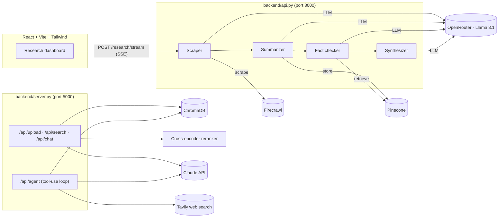

# Personal Research Assistant

An AI research assistant with three ways to research a topic:

1. **Multi-agent research dashboard.** Type a topic, and four agents find sources on the web, summarize them, fact-check the claims against each other, and write a cited report. You watch each agent's progress live.
2. **Chat with your documents (RAG).** Upload PDFs, Word files, text or Markdown, then ask questions. Answers come from the relevant passages and cite the source file.
3. **Tool-using research agent.** Claude decides for itself whether to search your documents, search the web, synthesize across documents, or flag an answer for human review. It keeps memory across turns.

The document-chat pipeline has an evaluation suite that runs in CI on every pull request. Adding cross-encoder reranking raised retrieval accuracy from **66% to 85%**.

---

## Features

### Multi-agent research pipeline (`backend/api.py` + `frontend/`)
- **Scraper agent:** an LLM picks relevant, publicly accessible URLs, and [Firecrawl](https://firecrawl.dev) scrapes them to Markdown.
- **Summarizer agent:** pulls the 5 key claims out of each source and stores the summaries in a Pinecone vector index.
- **Fact-checker agent:** checks each claim against the stored summaries and labels it *supported*, *contradicted* or *unverified*.
- **Synthesizer agent:** writes a structured Markdown report (executive summary, key findings, fact-check results, sources) with a confidence score, which is the share of claims supported.
- **Live progress:** the FastAPI endpoint streams each agent's start and finish as server-sent events, and the React dashboard shows them as status cards, followed by stats, the report and the source links.
- The agents use Llama 3.1 8B through [OpenRouter](https://openrouter.ai) (OpenAI-compatible API). Embeddings come from Pinecone's hosted `llama-text-embed-v2`.

### Document chat with RAG (`backend/server.py` + `backend/rag.py`)
- Upload `.pdf`, `.docx`, `.txt` and `.md` files (up to 16 MB). Text is extracted with PyPDF2 and python-docx.
- Documents are split into chunks of 1,000 characters with 200 characters of overlap and embedded with `all-MiniLM-L6-v2` (sentence-transformers). The chunks are stored in a persistent ChromaDB collection using cosine similarity.
- **Two-stage retrieval:** vector search returns the 20 nearest chunks, then a cross-encoder (`ms-marco-MiniLM-L-6-v2`) re-scores them against the question and keeps the top 3.
- Claude answers from the retrieved passages, cites the source filename, and streams the response token by token.
- Every setting (chunker, chunk size, overlap, top-k, reranking, models) lives in one `RAGConfig` object. You can change it with a JSON file or with `RAG_*` environment variables, without editing code.

### Tool-using agent (`backend/agent.py`)
- A ReAct-style loop with Claude tool use (up to 8 reasoning steps per turn) and four tools: `search_documents` (ChromaDB), `web_search` ([Tavily](https://tavily.com)), `summarize_topic`, and `flag_for_review` for uncertain or compliance-sensitive findings.
- Conversation memory is kept per session. Each response reports which tools were used and whether the answer was flagged.

---

## Evaluation

`backend/eval/` measures how well the document-chat pipeline finds and uses the right passage.

- **Test set:** 47 questions over 9 public-domain Python Enhancement Proposals (PEPs). Each question is tied to its source document, a verbatim evidence passage, and a key fact the answer must contain.
- **Metrics:**
  - **Retrieval accuracy:** the evidence passage is in the top 3 chunks.
  - **Answer accuracy:** the answer contains the key fact. This uses a text check or Claude as a grader.
  - **Citation accuracy:** the answer cites the right document.
  - **Time to first token:** average and p95.
- **Experiment:** 7 configurations were compared (chunk size, overlap, sentence-aware chunking, reranking):

| Configuration | Retrieval accuracy | Right document in top 3 |
|---|---|---|
| Baseline: fixed 1,000/200 chunks, vector search only | 66.0% | 97.9% |
| Sentence-aware chunks, 800 characters | 74.5% | 97.9% |
| **Baseline + cross-encoder reranking** (current default) | **85.1%** | **100%** |

Chunking changes alone helped less: the right document was almost always retrieved, but the wrong passage within it. Reranking fixed that, at the cost of about 1.5 s of extra latency per question on a laptop CPU.

- **CI:** `.github/workflows/eval.yml` runs the retrieval eval on every pull request that touches the pipeline. It fails the pull request if accuracy drops more than 3 points below the committed baseline in `backend/eval/results/`. If the repository has an `ANTHROPIC_API_KEY` secret, it also runs the full answer, citation and latency eval.

See [`backend/eval/README.md`](backend/eval/README.md) for details.

---

## Architecture



---

## Tech stack

| Layer | Tools |
|---|---|
| Frontend | React 19, TypeScript, Vite, Tailwind CSS 4, lucide-react |
| APIs | FastAPI + sse-starlette (multi-agent), Flask + Flask-CORS (RAG chat and agent) |
| LLMs | Claude Sonnet 4 (Anthropic API) for chat and the agent; Llama 3.1 8B via OpenRouter for the multi-agent pipeline |
| Retrieval | ChromaDB, sentence-transformers (`all-MiniLM-L6-v2` embeddings, `ms-marco-MiniLM-L-6-v2` cross-encoder), Pinecone with `llama-text-embed-v2` |
| Web data | Firecrawl (scraping), Tavily (search) |
| Documents | PyPDF2, python-docx |
| Evaluation and CI | Custom eval harness, GitHub Actions |
| Packaging | Dockerfile for the FastAPI service |

---

## Project structure

```
personal-research-assistant/
├── frontend/                  # React research dashboard
│   ├── src/App.tsx            # Search box, agent status cards, report view
│   ├── src/hooks/useResearch.ts  # Reads the SSE stream from /research/stream
│   └── vite.config.ts         # Proxies /research to localhost:8000
├── backend/
│   ├── api.py                 # FastAPI: multi-agent pipeline with SSE streaming
│   ├── agents/                # scraper, summarizer, fact_checker, synthesizer
│   ├── vector_store.py        # Pinecone upsert/search helpers
│   ├── server.py              # Flask: document upload, search, RAG chat
│   ├── rag.py                 # Shared RAG pipeline (chunking, retrieval, reranking, prompt)
│   ├── agent.py               # Flask blueprint: tool-using Claude agent
│   ├── eval/                  # Test set, corpus, configs, results, run_eval.py
│   ├── test_pipeline.py       # Runs the four agents end to end from the CLI
│   ├── test_agent.py          # Smoke test for /api/agent
│   └── Dockerfile             # Runs api.py with uvicorn on port 8000
└── .github/workflows/eval.yml # RAG eval on every PR
```

---

## Getting started

### Prerequisites
- Python 3.11+ and Node.js 20+
- API keys for the features you want to use:

| Variable | Used by |
|---|---|
| `OPENROUTER_API_KEY` | Multi-agent pipeline (LLM) |
| `FIRECRAWL_API_KEY` | Multi-agent pipeline (scraping) |
| `PINECONE_API_KEY`, `PINECONE_INDEX_NAME` (default `research-index`) | Multi-agent pipeline (vector store); the index needs 1,024 dimensions for `llama-text-embed-v2` |
| `ANTHROPIC_API_KEY` | Document chat, tool-using agent, full eval |
| `TAVILY_API_KEY` | Tool-using agent (web search) |

Put them in `backend/.env`. This file is ignored by Git.

```env
OPENROUTER_API_KEY=...
FIRECRAWL_API_KEY=...
PINECONE_API_KEY=...
PINECONE_INDEX_NAME=research-index
ANTHROPIC_API_KEY=...
TAVILY_API_KEY=...
```

### 1. Multi-agent research dashboard

```bash
cd backend
python -m venv .venv && source .venv/bin/activate   # Windows: .venv\Scripts\activate
pip install -r requirements.txt openai
uvicorn api:app --reload --port 8000
```

In a second terminal:

```bash
cd frontend
npm install
npm run dev
```

Open the URL Vite prints (usually http://localhost:5173), enter a topic and click **Research**.

### 2. Document chat and tool-using agent

```bash
cd backend
pip install -r eval/requirements.txt flask flask-cors PyPDF2 python-docx anthropic tavily-python
python server.py          # http://localhost:5000
```

```bash
# Upload a document
curl -F "file=@paper.pdf" http://localhost:5000/api/upload

# Ask about it (streams server-sent events)
curl -N -X POST http://localhost:5000/api/chat \
  -H "Content-Type: application/json" \
  -d '{"messages":[{"role":"user","content":"What are the key findings?"}]}'

# Ask the tool-using agent
curl -X POST http://localhost:5000/api/agent \
  -H "Content-Type: application/json" \
  -d '{"message":"Summarize my documents and check for recent updates online","session_id":"demo"}'
```

To change RAG settings, set `RAG_CONFIG=eval/configs/<name>.json` or individual variables such as `RAG_RERANK=false` or `RAG_CHUNK_SIZE=800`.

### 3. Run the evaluation

```bash
cd backend
python eval/run_eval.py --retrieval-only                 # about a minute, no API key needed
python eval/run_eval.py --grader claude                  # full eval, needs ANTHROPIC_API_KEY
python eval/run_eval.py --sweep eval/configs/*.json      # compare configurations
```

---

## API reference

| Service | Method and path | Description |
|---|---|---|
| FastAPI | `POST /research/stream` | Body `{query, num_sources}`. Streams `agent_start`, `agent_done`, `report` and `error` events. |
| FastAPI | `GET /health` | Health check |
| Flask | `POST /api/upload` | Multipart `file`. Extracts, chunks, embeds and indexes it. |
| Flask | `GET /api/documents` | Lists uploaded documents |
| Flask | `DELETE /api/documents/<id>` | Deletes a document and its embeddings |
| Flask | `POST /api/search` | Body `{query, top_k}`. Semantic search with reranking. |
| Flask | `POST /api/chat` | Body `{messages, use_rag}`. Streams Claude's answer as SSE. |
| Flask | `POST /api/agent` | Body `{message, session_id}`. Returns `{answer, tools_used, flagged, iterations}`. |
| Flask | `DELETE /api/agent/session/<id>` | Clears an agent session's memory |
| Flask | `GET /api/health`, `GET /api/agent/health` | Status, document count and RAG config |

---

## Current limitations and roadmap

- The React dashboard covers the multi-agent pipeline only. Document chat and the tool-using agent are API-only for now; a UI for upload and chat is next.
- The list of uploaded documents and the agent's session memory are held in memory and reset when the Flask server restarts. The embeddings in ChromaDB persist.
- Reranking adds about 1.5 s per question on CPU. Next steps are a smaller or GPU-hosted reranker, or reranking fewer candidates.
- Deployment is scaffolded but not finished: `docker-compose.yml`, `infra/` (Terraform) and `.github/workflows/deploy.yml` are placeholders.

## License

This is a personal learning project, shared for educational purposes.
